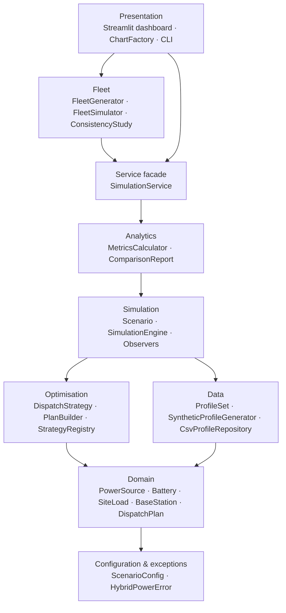
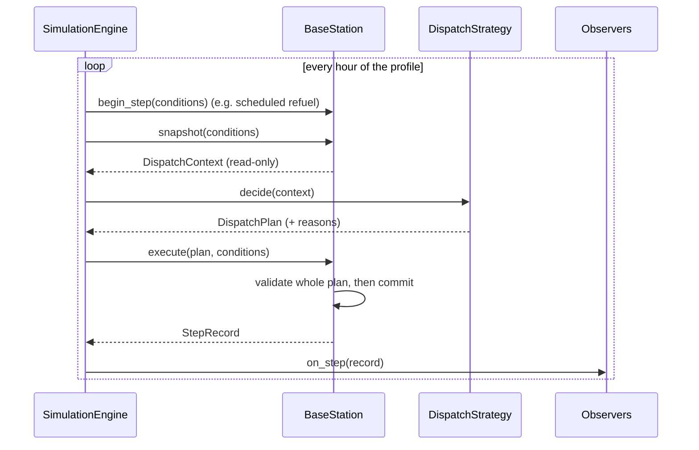
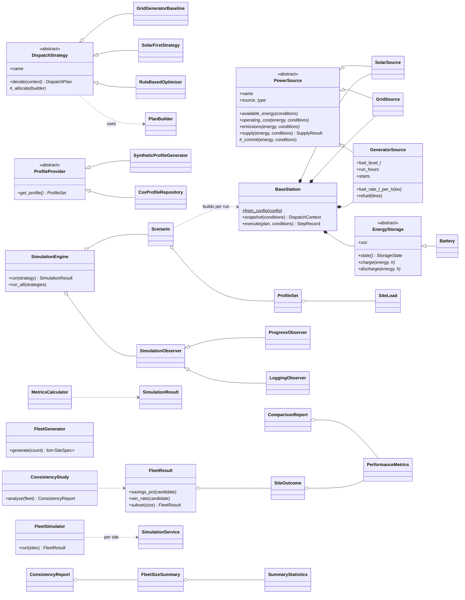

# Hybrid Power Optimiser for Telecom Base Stations

[](https://github.com/kallyas/oop-course-project/actions/workflows/ci.yml)


An object-oriented Python **decision-support simulator** that decides, hour by hour, how a
telecom base station should use **solar PV, the utility grid, battery storage and a diesel
generator**. It compares an optimised dispatch strategy against a legacy baseline and reports
operating cost, diesel use, generator hours, CO₂ emissions, renewable share and reliability. An
interactive Streamlit dashboard presents the results.

> **CSC8101 Object-Oriented Programming, Advent 2026.** Tumuhirwe Iden (S26M25/011),
> Uganda Christian University.
>
> The system is a simulator. It does **not** connect to, switch or control real electrical equipment.

---

## Contents

1. [Problem](#problem)
2. [Features](#features)
3. [Quick start](#quick-start)
4. [Using the system](#using-the-system)
5. [Architecture](#architecture)
6. [Object-oriented design](#object-oriented-design)
7. [Dispatch strategies](#dispatch-strategies)
8. [Models and assumptions](#models-and-assumptions)
9. [Sample results](#sample-results)
10. [Fleet consistency study](#fleet-consistency-study)
11. [Testing and quality](#testing-and-quality)
12. [Project structure](#project-structure)
13. [Limitations and future work](#limitations-and-future-work)
14. [References](#references)

---

## Problem

Telecom base stations need continuous power, yet many sites face grid outages and time-of-use
tariffs. Diesel generators provide backup, but they burn fuel, need maintenance and emit CO₂. Solar
and batteries can cut diesel use, but their output and stored energy are limited. Operators therefore
need a principled way to decide **which source should serve the load at each hour**. This project
models that decision with OOP and evaluates it on realistic simulated data.

## Features

- **Domain model** of a site: `SolarSource`, `GridSource` and `GeneratorSource` (all `PowerSource`),
  plus a `Battery` (`EnergyStorage`), `SiteLoad` and the `BaseStation` aggregate. Every value is
  validated, so no object can enter an invalid state.
- **Three interchangeable dispatch strategies** (Strategy pattern): a legacy baseline, a greedy
  solar-first strategy and a tariff- and resilience-aware rule-based optimiser.
- **Explainable decisions.** Every hourly step records *why* each source was used, in a decision log.
- **Transactional execution.** A plan is fully validated before any component state changes.
- **Realistic synthetic data.** Telecom traffic-shaped demand, a clear-sky solar model with
  Beta-distributed daily clearness, Markov-chain grid outages and time-of-use tariffs. Generation is
  reproducible from a seed.
- **CSV import/export** of operating profiles, so you can run the system on measured site data.
- **KPIs.** Total and per-kWh cost, diesel litres, run hours, starts, CO₂, renewable fraction,
  solar curtailment, unmet energy and LPSP. These feed a baseline comparison and a ranking.
- **Calendar heatmaps.** An hour × day grid and a weekday calendar of energy or cost (hover shows
  both), plus a savings calendar that shows on which days the optimiser beats the baseline.
- **Fleet consistency study.** Simulates up to hundreds of varied base stations and tests whether
  the conclusions drawn from a few sites hold for many, using bootstrap confidence intervals.
- **Interactive dashboard** (Streamlit + Plotly) and a **command-line interface**.
- **Quality.** Strict `mypy` typing, `ruff` linting, 220 tests with Hypothesis property-based
  invariants, 98% coverage, and GitHub Actions CI on Python 3.10 to 3.13.

## Quick start

Requires **Python 3.10 or newer** (use a recent patch release; see the note in
[Testing and quality](#testing-and-quality)).

```bash
git clone https://github.com/kallyas/oop-course-project.git
cd oop-course-project
python -m venv .venv && source .venv/bin/activate      # Windows: .venv\Scripts\activate
pip install -e ".[dev]"

streamlit run streamlit_app.py                           # dashboard at http://localhost:8501
hybrid-power simulate                                    # or: compare strategies in the terminal
```

## Using the system

### Dashboard

```bash
streamlit run streamlit_app.py      # or: hybrid-power dashboard
```

The sidebar controls every input from the proposal: simulation days, site demand, solar availability
(PV size, sky clearness, cloud variability), grid availability (outage frequency and duration),
peak and off-peak tariffs, diesel price, battery capacity, SoC window and initial charge, generator
size and tank, and the optimiser rules. You can upload your own profile CSV, and save or reload a
scenario as JSON.

| Tab               | Content                                                                  |
| ----------------- | ------------------------------------------------------------------------ |
| KPI header        | Optimiser vs baseline: cost, diesel, CO₂, renewable share, run hours, unmet demand |
| **Comparison**    | Cost breakdown, energy mix, fuel/hours/CO₂, cumulative cost, KPI table    |
| **Power flow**    | Hourly stacked power flow, battery SoC for all strategies, daily energy  |
| **Heatmaps**      | Hour × day grid and weekday calendar of energy or cost, and a calendar of daily savings vs baseline |
| **Decision log**  | Each hour's decision and its reasons, filterable by outage or unmet hours |
| **Fleet study**   | Few vs many base stations: convergence chart, per-site savings, savings drivers, consistency verdict |
| **Input profile** | Demand, PV potential, grid status and tariff over time                    |
| **Export**        | Download scenario JSON, profile CSV, KPI CSV and hourly results          |

### Command line

```bash
hybrid-power simulate                                    # default 30-day scenario, all strategies
hybrid-power simulate --days 60 --seed 7                 # override horizon / random seed
hybrid-power simulate --config data/sample_scenario.json \
                      --profile data/sample_profile_30d.csv --export-dir results/
hybrid-power simulate --strategy optimizer               # baseline is always added for comparison
hybrid-power fleet --sites 50                            # few vs many base stations
hybrid-power fleet --sizes 1 5 10 25 50 --export-dir results/
hybrid-power generate-profile --days 30 --output data/my_profile.csv
hybrid-power --help
```

### Jupyter notebook

`notebooks/hybrid_power_study.ipynb` is a self-contained computational study built on the
library. It sets out the mathematical model, validates the stochastic inputs against theory,
checks the simulator's energy and SoC invariants at every step, attributes the savings to cost
components, and runs tornado and sizing-sweep sensitivity analyses. It also runs a paired Monte
Carlo experiment with bootstrap confidence intervals and a sign test, an ablation of the
optimiser's rules, and the fleet consistency study.

```bash
pip install -e ".[notebook]"
jupyter lab notebooks/hybrid_power_study.ipynb
HP_NOTEBOOK_FAST=1 jupyter execute notebooks/hybrid_power_study.ipynb   # quick headless run (CI)
```

### As a library

```python
from hybrid_power import ScenarioConfig, SimulationService, BatteryConfig

config = ScenarioConfig(battery=BatteryConfig(capacity_kwh=50))
outcome = SimulationService().run(config)

print(outcome.report.to_frame()[["total_cost", "fuel_used_l", "renewable_fraction"]])
print(outcome.report.comparison("optimizer").cost_savings_pct)
print(outcome.results["optimizer"].frame["reasons"].head())
```

### Profile CSV format

| column           | type             | meaning                                   |
| ---------------- | ---------------- | ----------------------------------------- |
| `timestamp`      | datetime         | start of the step (evenly spaced)          |
| `demand_kw`      | float ≥ 0        | average site load                          |
| `solar_factor`   | float in [0, 1]  | PV output as a fraction of rated capacity  |
| `grid_available` | bool / 0-1 / yes-no | grid energised during the step          |
| `tariff_per_kwh` | float ≥ 0        | grid energy price                          |

## Architecture

The code is organised in **layers**. Each layer depends only on the layers below it, so the domain
model knows nothing about strategies, simulation or user interfaces.



### One simulation step



### Class diagram (core)



## Object-oriented design

### The four pillars

| Principle         | Where it appears |
| ----------------- | ---------------- |
| **Encapsulation** | Component state is private (`_soc`, `_fuel_level_l`) and exposed through read-only properties. `Battery.soc` has a *validating setter*. Arrays in `SiteLoad`/`ProfileSet` are frozen (`setflags(write=False)`). Configuration and records are immutable frozen dataclasses. Strategies receive an immutable `DispatchContext`, never the live station. |
| **Abstraction**   | `PowerSource`, `EnergyStorage`, `DispatchStrategy` and `ProfileProvider` are ABCs that define *what* a component does. The engine and analytics depend only on these abstractions. |
| **Inheritance**   | `SolarSource`, `GridSource` and `GeneratorSource` extend `PowerSource`; the three strategies extend `DispatchStrategy`; the profile providers and observers extend their base classes; and `ConfigSection` is a serialisation mixin shared by every config class. |
| **Polymorphism**  | The engine calls `strategy.decide()` without knowing the concrete strategy. `station.sources` is iterated uniformly. Generators override hooks (`minimum_energy`, `begin_step`, `_commit`) to add fuel, minimum-load and refuel behaviour. Every override is marked `@override`, so mypy checks it against the base class. |

### Design patterns

| Pattern             | Implementation | Benefit |
| ------------------- | -------------- | ------- |
| Strategy            | `DispatchStrategy` + three strategies | Compare control policies on identical data |
| Template Method     | `PowerSource.supply`, `DispatchStrategy.decide` | Shared bookkeeping in the base class; subclasses supply only what differs |
| Builder             | `PlanBuilder` | Strategies cannot produce infeasible plans |
| Factory Method      | `BaseStation.from_config` | Each run starts from a fresh, consistent station |
| Registry            | `StrategyRegistry` | New strategies plug in without editing the engine or UI |
| Observer            | `SimulationObserver`, `ProgressObserver`, `LoggingObserver` | Progress bars and logging without coupling to the engine |
| Repository          | `CsvProfileRepository` | Persistence is isolated from the domain |
| Facade              | `SimulationService` | UI code stays thin; the CLI and dashboard share one entry point |
| Value Object        | `OperatingConditions`, `DispatchPlan`, `StepRecord`, configs | Immutable and safe to share and cache |

### Error handling

All deliberate errors derive from `HybridPowerError`:

```
HybridPowerError
├── ConfigurationError        (invalid configuration / argument; also a ValueError)
├── ProfileDataError          (malformed time series or CSV; also a ValueError)
├── OperatingLimitError       (a physical limit would be violated)
│   └── CapacityExceededError
├── DispatchError             (inconsistent or infeasible plan)
└── StrategyNotFoundError     (unknown strategy name; also a KeyError)
```

The CLI turns these errors into a one-line message with exit code 2. The dashboard shows them as
an error banner instead of a stack trace.

## Dispatch strategies

| Strategy | Rule summary |
| -------- | ------------ |
| `baseline` (`GridGeneratorBaseline`) | Legacy site: grid when available, otherwise the generator follows the load. Solar and battery are ignored. |
| `solar_first` (`SolarFirstStrategy`) | Greedy merit order: solar → battery → grid → generator. Blind to tariffs and outage risk. |
| `optimizer` (`RuleBasedOptimizer`, alias `PowerOptimizer`) | See below. |

**Optimiser rules** (all thresholds are configurable in `OptimizerConfig`):

1. Solar serves the load first; surplus solar charges the battery.
2. **Grid connected:**
   - At *peak* tariff, the battery discharges only down to an **outage reserve** SoC, keeping
     backup energy for the next outage. The grid covers the rest.
   - At *off-peak* tariff, and only when there is no PV output, the grid tops the battery up to a
     target SoC. This is energy arbitrage that also improves resilience, and it leaves room for the
     next day's solar.
3. **Grid outage:**
   - If the battery alone can carry the load, it does, avoiding a generator start.
   - Otherwise the generator runs. In **cycle-charging** mode it runs at about 80% of rating, an
     efficient operating point, and the surplus recharges the battery.
   - **Hysteresis** keeps the generator running until the battery reaches a stop SoC, which
     prevents short cycling.
4. Any remaining demand is recorded as unmet and explained in the decision log.

## Models and assumptions

- **Time step:** hourly by default. Any evenly spaced step loaded from CSV is also supported.
- **Generator fuel:** linear consumption `F = 0.246·P_out + 0.08415·P_rated` (L/h) [1].
  The generator has a minimum stable load of 30% of rating, emits 2.68 kg CO₂ per litre of
  diesel [2] and incurs a maintenance cost per run hour. Fuel limits available output. The tank can
  be refilled on a schedule.
- **Battery:** charge and discharge efficiencies, kW power limits, a [min, max] SoC window and a
  wear cost per kWh of throughput. A step cannot both charge and discharge the battery.
- **Solar:** half-sine clear-sky shape between 06:00 and 18:00, multiplied by a Beta-distributed
  daily clearness index.
- **Grid:** a two-state Markov chain with failure probability `outages_per_day / 24` and repair
  probability `1 / mean_outage_hours` per hour. The tariff has peak and off-peak levels.
- **Demand:** base-to-peak load following a normalised 24-hour mobile-traffic profile, plus
  Gaussian noise.
- **Default currency:** USD. Prices are illustrative and can be edited in the scenario JSON or the
  dashboard.

## Sample results

The default 30-day scenario (`data/sample_scenario.json`) models an 8 kWp PV array, a 30 kWh
battery and a 10 kW generator, with grid availability of about 89%:

```
               cost (USD)  diesel (L)  gen hours  CO2 (kg)  renewable  unmet (kWh)
baseline           549.89      136.17      82.00    577.20       0.00         0.00
solar_first        322.37       83.04      52.00    324.83       0.51         0.00
optimizer          239.72       30.90      11.00    201.32       0.47         0.00

optimizer: saves 310.17 USD (56.4%), 105.3 L diesel, 375.9 kg CO2 vs baseline
```

The optimiser's renewable fraction is slightly *lower* than solar-first's, because it buys cheap
off-peak grid energy to keep an outage reserve. In exchange it cuts generator hours by 79% compared
with solar-first. The off-peak charge target controls this cost-versus-renewables trade-off, and you
can explore it in the dashboard.

## Fleet consistency study

A single simulated site is one sample. To check whether the conclusions **generalise**, the fleet
study builds a network of base stations from the scenario. Each site keeps the same equipment but
draws its own load level (0.7–1.4×), outage frequency (0.2–3 per day), outage duration (1–6 h) and
sky clearness (0.5–0.85). Every strategy is simulated at every site.

The sites are drawn from one seeded random stream, so the 5-site fleet is the first 5 sites of the
50-site fleet. For each fleet size (1, 5, 10, 25 and 50 sites) the study reports:

- the mean cost saving with a 95% **percentile-bootstrap** confidence interval,
- the **win rate** (share of sites where the optimiser is cheaper without serving less load),
- which strategy is cheapest across the fleet while staying at least as reliable as the baseline,
- a verdict on two kinds of consistency:
  - **Direction:** does every fleet size recommend the same strategy, and does it win at most sites?
  - **Magnitude:** does every fleet's mean saving fall inside the confidence interval of the
    largest fleet?

```
hybrid-power fleet --sites 50

       mean saving %  CI low %  CI high %  win rate recommended
sites
1              71.05         -          -      1.00   optimizer
5              64.45     58.97      69.93      1.00   optimizer
10             62.59     58.88      66.60      1.00   optimizer
25             58.49     54.87      61.80      1.00   optimizer
50             59.21     56.55      61.68      1.00   optimizer
```

**Finding:** the *direction* of the result is fully consistent. The optimiser is recommended at
every fleet size and wins at 100% of the 50 sites. The *magnitude* is not: one to ten sites
overstate the saving (71% → 63%), and the estimate settles at about 59% ± 2.6 pp only from roughly
25 sites. The "what drives the saving" chart shows why. Sites with few outages save less, because
the baseline rarely runs its generator there. So a conclusion drawn from one site is right about
*which* strategy to choose, but cannot be trusted for the *size* of the saving.

## Testing and quality

```bash
pytest                         # 220 tests
pytest --cov                   # with branch coverage (≈98%)
mypy                           # strict type checking of src/ and tests/
ruff check . && ruff format --check .
```

The test suite contains:

- **Unit tests** for every class: validation, limits, fuel model, efficiencies, plan building,
  each optimiser rule, and the registry.
- **Scenario tests** from the proposal: normal operation, grid outages, low battery, no solar,
  insufficient fuel and invalid input.
- **Property-based tests** (Hypothesis) on randomly generated scenarios. For every strategy and
  every step, they check that the energy balance closes, SoC stays in its window, fuel never goes
  negative, nothing is imported during an outage, and the battery never charges and discharges in
  the same step.
- **Determinism tests:** the same seed gives identical results.
- **Fleet tests:** nested sampling, bootstrap statistics, and both consistent and inconsistent
  verdicts built from hand-made fleets.
- **Chart tests** that check heatmap cells against the hourly records (for example, a day's cost
  cells sum to that day's cost).
- **Headless dashboard tests** using Streamlit's `AppTest`, including running the fleet form.

**Continuous integration** (`.github/workflows/ci.yml`) runs on every push and pull request. It
runs ruff and strict mypy, the test matrix on Python 3.10 to 3.13 with a 90% coverage floor, and a
CLI smoke test whose results are uploaded as an artifact.

> **Note:** Python **3.10.0** (the very first 3.10 release) triggers an internal Hypothesis error.
> Any later 3.10.x patch, or Python 3.11 to 3.13, works.

## Project structure

```
├── src/hybrid_power/
│   ├── config.py              # validated, serialisable scenario configuration
│   ├── exceptions.py          # exception hierarchy
│   ├── service.py             # SimulationService facade
│   ├── cli.py                 # `hybrid-power` command-line interface
│   ├── domain/                # sources, battery, load, station, dispatch value objects
│   ├── data/                  # ProfileSet, synthetic generator, CSV repository
│   ├── optimization/          # strategies, PlanBuilder, StrategyRegistry
│   ├── simulation/            # Scenario, SimulationEngine, observers, results
│   ├── analytics/             # PerformanceMetrics, MetricsCalculator, ComparisonReport
│   ├── fleet/                 # FleetGenerator, FleetSimulator, SummaryStatistics, ConsistencyStudy
│   └── presentation/          # ChartFactory (Plotly) and Streamlit dashboard
├── tests/                     # pytest + Hypothesis + Streamlit AppTest
├── data/                      # sample scenario JSON and 30-day profile CSV
├── notebooks/                 # Jupyter computational study
├── streamlit_app.py           # dashboard entry point
├── .github/workflows/ci.yml   # continuous integration
└── pyproject.toml             # packaging and tool configuration
```

## Limitations and future work

- Each site is simulated independently, with deterministic, rule-based dispatch. Sites in the fleet
  study do not share resources such as fuel logistics or maintenance crews. A natural extension is
  forecast-driven optimisation, for example a mixed-integer program or model-predictive control,
  added as another `DispatchStrategy`.
- The grid and generator are modelled as energy flows. Power-flow engineering, voltage and
  frequency are outside the scope.
- Battery degradation is a linear cost per kWh of throughput, with no capacity fade.
- Data is synthetic unless a measured profile CSV is supplied. Live weather and sensor feeds could
  be added as new `ProfileProvider` implementations.

## References

[1] R. Dufo-López and J. L. Bernal-Agustín, "Multi-objective design of PV–wind–diesel–hydrogen–battery
systems," *Renewable Energy*, vol. 33, no. 12, pp. 2559–2572, 2008. (Linear diesel fuel-consumption model.)

[2] U.S. Environmental Protection Agency, "Emission Factors for Greenhouse Gas Inventories," 2024.

[3] T. Lambert, P. Gilman and P. Lilienthal, "Micropower system modeling with HOMER," in
*Integration of Alternative Sources of Energy*, Wiley, 2006. (Load-following vs. cycle-charging dispatch.)

[4] E. Gamma, R. Helm, R. Johnson and J. Vlissides, *Design Patterns: Elements of Reusable
Object-Oriented Software*. Addison-Wesley, 1994.

## License

MIT. See [LICENSE](LICENSE).
